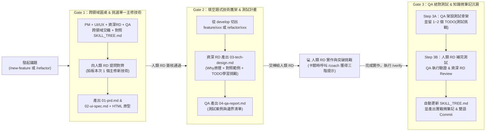

# 03. 三階段簽核關卡與「邊做邊學」導師制工作流 (3-Gate Mentorship Workflow)

所有「新需求開發 (`/new-feature`)」與「舊程式碼重構 (`/refactor`)」皆須遵循以下三階段簽核關卡 (Stage Gates)、**「單次 1 個新技術學習預算 (1-New-Concept Budget)」** 與 [GIT_WORKFLOW.md](../../GIT_WORKFLOW.md) 規範：

## 各關卡執行細則

### Gate 1：跨領域圓桌討論 ➔ 需求、UI 與「本次單一主修技術」定案
1. **跨領域交織碰撞 + 技能樹對照**：
   - 針對主題，綜合 PM（產品價值）、UI/UX（操作體驗）、資深 RD（架構與 [`docs/learning/SKILL_TREE.md`](../../docs/learning/SKILL_TREE.md) 學習機會）、QA（極端狀況）進行交織分析。
   - **認知負荷控制 (1-New-Concept Budget)**：每次任務嚴格限定挑選 **1 個核心新技術焦點**（例如：本次主修 `A3. Sealed UiState`，其餘部分使用已熟悉的寫法），避免一次塞入過多新技術。
2. **結構化訪談**：透過 `ask_question` 向人類 RD 確認功能細節與本次想挑戰的單一技術節點。
3. **產出與停駐等待簽核**：
   - 寫入 `docs/specs/<slug>/01-prd.md`（含本次主修技術節點記錄）
   - 寫入 `docs/specs/<slug>/02-ui-spec.md` 與 `docs/specs/<slug>/prototype.html`
   - **必須暫停並等待人類 RD 確認 Gate 1 通過後，才可進入 Gate 2**。

### Gate 2：Git 分支準備 ➔ 「Why + 對比範例 + 填空題式鷹架」與測試計畫
1. **Git Flow 分支檢核**：確認位於最新的 `develop` 分支，並切出 `feature/<slug>` 或 `feature/refactor-<slug>`。
2. **資深 RD 產出導師制技術設計書 (`03-tech-design.md`)**：
   - **Why 與底層原理剖析**：解釋為什麼本次主修的新技術優於專案舊寫法。
   - **Before vs. After 觀念對比**：展示舊 Java 寫法與現代 Kotlin 寫法的差異（使用通用範例，不直接洩漏本次任務完整答案）。
   - **填空題式鷹架 (`// TODO(學習挑戰)`)**：提供完整類別結構、Method 簽章與 XML View ID 對照表，但在核心學習處留下 `// TODO(學習挑戰): [思考提示與建議 API]`，讓人類 RD 親手思考與實作（**嚴禁直接修改 `app/src/main/`**）。
3. **QA 產出測試計畫 (`04-qa-report.md` Part A)**。
4. **交棒給人類 RD 實作**：若人類 RD 在挑戰 `// TODO(學習挑戰)` 時卡關，可隨時呼叫 **`/coach`** 獲得「三段式漸進提示」。

### Gate 3：QA 結對測試 (Pair Testing) ➔ 聯合驗收與知識微筆記歸檔
1. **Step 3A（QA 架設測試骨架 + 預留測試挑戰）**：
   - 當人類 RD 完成業務邏輯並呼叫 `/verify` 時，`qa_agent` 先於 `app/src/test/` 建立測試類別，寫好繁瑣的 Mock/Dispatcher 設定與大部分邊界測試，但刻意留下 **1～2 個核心測試方法標註 `// TODO(測試挑戰)`** 邀請人類 RD 親手用 MockK / Turbine 補完（若人類 RD 當下趕時間想跳過手寫測試，也可告知由 QA 全數補齊）。
2. **Step 3B（測試執行、Code Review 與知識沉澱）**：
   - 執行 `./gradlew testDebugUnitTest` 驗證測試通過，並由資深 RD 針對 `git diff` 進行 Code Review。
   - **自動沉澱學習資產**：
     1. 將 [`docs/learning/SKILL_TREE.md`](../../docs/learning/SKILL_TREE.md) 對應節點更新為 `✅ 已掌握`。
     2. 在 `docs/learning/notes/` 產出本次的《實戰學習微筆記》（含專案內的 Before/After 對照與資深 Android 面試考點）。
     3. 產出符合 [GIT_WORKFLOW.md](../../GIT_WORKFLOW.md) 格式的中英雙語 Commit Message。
