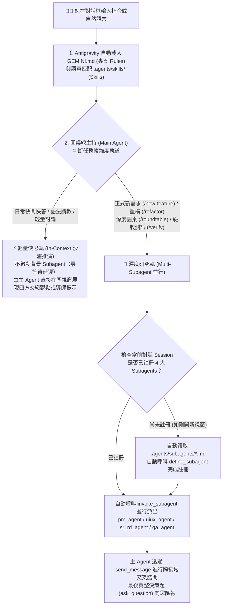

# 宅影視 (Nerdia) — Google Antigravity AI 團隊與「邊做邊學」導師制工作流總指南 (`AI_WORKFLOW_GUIDE.md`)

這份文件定義了「宅影視 (Nerdia)」在 **Google Antigravity App** 中的 **4+1 跨領域 AI Agent 團隊 + 導師制學習工作模式 (Mentorship-Driven Workflow)**，涵蓋全域與專案設定、**Custom Subagents 自動觸發機制**、角色權限紅線、三階段簽核關卡（Stage Gates）、**個人技術演進技能樹 (`SKILL_TREE.md`)**、Figma 雙軌串接與 **8 大完整實戰使用情境全書**。

---

## 1. 全景架構：8 大核心組件總覽

| 編號 | 核心層級 | 檔案 / 元件位置 | 解決的核心痛點 |
| :---: | :--- | :--- | :--- |
| **1** | **全域 Rules & 預設 Role** | [`~/.gemini/GEMINI.md`](file:///shared/user/.gemini/GEMINI.md) | 將主對話預設為「**AI 研發團隊總主持兼資深技術顧問 (Orchestrator)**」，建立「先提問對齊、不擅自改業務 Code」的全域紀律。 |
| **2** | **專案級 Rules (Workspace Rules)** | [`GEMINI.md`](GEMINI.md) & [`.agents/rules/`](.agents/rules/) | 每次開啟專案**100% 自動載入**，鎖定 Nerdia 技術方向（Java 8 ➔ Kotlin 漸進遷移、UI 維持 Android XML Layout）與 **Subagent 自動掛載協議**。 |
| **3** | **4 大專職 Custom Subagents** | [`.agents/subagents/`](.agents/subagents/) | 定義 `pm_agent`、`uiux_agent`、`sr_rd_agent`（**強制唯讀導師沙盒**）、`qa_agent`（**結對測試教練**）。 |
| **4** | **6 大工作流 Skills (`/slash`)** | [`.agents/skills/`](.agents/skills/) | 支援 `/new-feature`、`/refactor`、`/roundtable`、`/ui-spec`、`/verify`、以及技術導師 **`/coach`**（支援斜線呼叫與自然語言語意自動觸發）。 |
| **5** | **跨對話永久記憶庫 (SSOT)** | [`docs/specs/<slug>/`](docs/specs/README.md) | 解決多 Agent 與跨日對話「失憶問題」，將 PRD、UI 規格、互動 HTML 原型、技術藍圖與 QA 報告隨 `feature/` 分支版控。 |
| **6** | **個人技術演進技能樹與筆記庫** | [`docs/learning/SKILL_TREE.md`](docs/learning/SKILL_TREE.md) | 依據 Nerdia 原始碼現況量身打造 4 大技能分支（UDF/Flow、DI/Clean Arch、進階 XML/Paging 3、MockK/Turbine 測試），每次完成任務自動累積《實戰微筆記》。 |
| **7** | **導師制「填空題鷹架」與「結對測試」** | [`03-workflow-and-git-gates.md`](.agents/rules/03-workflow-and-git-gates.md) | 避免「AI 給完整答案導致看過就忘」：Gate 2 採用 `// TODO(學習挑戰)` 填空鷹架；Gate 3 採用 QA `// TODO(測試挑戰)` 結對測試！ |
| **8** | **UI/UX 雙軌原型與 Figma 橋接** | [`/ui-spec`](.agents/skills/ui-spec/SKILL.md) | 結合 Antigravity 內建 **1:1 手機互動式 HTML 原型 (`generative_ui`) + XML 標註規格書**，並支援匯入 Figma 或串接 Figma MCP。 |

---

## 2. 核心機制解答：Custom Subagents 會自動觸發嗎？

**答案是：會！透過「Rules + Skills 雙重自動掛載機制」自動註冊並觸發，您完全不需要手動建立或手動一個個呼叫 Subagent。**

為了讓您徹底掌握 Antigravity 的底層運作邏輯，以下說明系統在背後是如何自動運作的：

### 為什麼這樣設計？
1. **跨新對話視窗也不會失效（Auto-Bootstrap）**：
   - 在 Antigravity 底層，`define_subagent` 建立的 Subagent 生命週期綁定於「單一對話視窗 (Session)」。
   - 但因為我們已將 4 大角色的完整 Prompt 與權限寫入 [`.agents/subagents/`](.agents/subagents/README.md)，並在 [`GEMINI.md`](GEMINI.md) 第三條寫死了**「跨對話自動掛載協議」**——每當您開啟一個全新的對話視窗並進入開發/重構/驗收流程時，主 Agent 會**自動在背景讀取設定檔並註冊這 4 位 Subagents**。
2. **兩種觸發方式皆支援**：
   - **方式一：斜線指令明確觸發（最推薦、最精準）**：直接輸入 `/new-feature`、`/refactor`、`/roundtable`、`/ui-spec`、`/verify`、`/coach`。
   - **方式二：自然語言語意自動觸發（Semantic Discovery）**：即使您忘記打斜線指令，直接打字說「我想重構 `HomeViewModel`」、「我寫完程式碼了幫我跑測試驗收」，Antigravity 也會根據每個 Skill 的 `description` 自動載入對應的 `SKILL.md` 並喚醒對應的 Subagents！

---

## 3. 團隊角色分配與「動手寫 Code」嚴格邊界 (4+1 編制)

| 角色 | 核心產出物與導師職責 | 可以修改 `app/src/main/` (業務與 XML)？ | 可以修改 `app/src/test/` (單元測試)？ |
| :--- | :--- | :---: | :---: |
| **🎯 PM (`pm_agent`)** | `01-prd.md`（需求探索、主動訪談、驗收條件） | ❌ 禁止 | ❌ 禁止 |
| **🎨 UI/UX (`uiux_agent`)** | `02-ui-spec.md` + `prototype.html` + Figma 結構 | ❌ 禁止（保留給您練習切 XML） | ❌ 禁止 |
| **🏗️ 資深 RD (`sr_rd_agent`)** | `03-tech-design.md`（**Why 原理 + 新舊對照 + `// TODO(學習挑戰)` 鷹架**）+ Code Review | ❌ **嚴格禁止（除非您明確下令代寫）** | ❌ 禁止 |
| **🛡️ QA (`qa_agent`)** | `04-qa-report.md` + **結對測試骨架（預留 1~2 個 `// TODO(測試挑戰)` 給您練習）** | ❌ 禁止（發現 Bug 僅出報告交由您修） | ✅ **主動架設測試並批改** |
| **👨‍💻 RD (您)** | 拍板決策、切 XML Layout、突破業務與測試 `TODO` 挑戰 | ✅ **完全主導** | ✅ **結對練習關鍵測試案例** |

---

## 4. 完整 8 大實戰使用情境全書 (Complete Playbook)

以下列出您在開發「宅影視 (Nerdia)」時會遇到的**所有 8 種使用情境**、**您該怎麼輸入**，以及 **AI 團隊在背後的反應流程**：

---

### 📍 情境一：不知道今天該改什麼，或想挑一項新 Android 技術來練手
- **適用時機**：週末或下班打開專案，想看目前技能樹進度，請資深 RD 推薦一個規模適中、適合練習新技術的模組。
- **您該如何輸入**：
  > `/coach`
  > *(或輸入：`/coach 我今天有 2 小時，請推薦我下一個技能樹修練任務`)*
- **AI 團隊會做什麼**：
  1. 自動讀取 [`docs/learning/SKILL_TREE.md`](docs/learning/SKILL_TREE.md) 檢視您目前的解鎖進度（Lv.1 ➔ Lv.2 ➔ Lv.3）。
  2. 掃描 Nerdia 原始碼，挑出 **2～3 個具體練手提案**（例如：「提案 1：重構 `OmdbRepository` 練習 **A2. Retrofit `suspend` 協程**」、「提案 2：重構 `GenresAdapter` 練習 **C2. `ListAdapter + DiffUtil`**」）。
  3. 跳出選擇題 (`ask_question`) 讓您挑選；您點選後即可無縫銜接進入 `/refactor` 或 `/new-feature`！

---

### 📍 情境二：腦中有個新點子或架構疑問，想先找團隊「跨領域腦力激盪」
- **適用時機**：還不確定要不要正式開發，想先聽聽 PM、UI/UX、資深 RD 與 QA 四個角度怎麼看這個點子，有沒有沒想到的大坑。
- **您該如何輸入**：
  - **日常快速討論（輕量快思軌）**：
    > `/roundtable 我想在首頁新增一個「今日隨機推薦一部電影（抽卡模式）」功能，大家覺得如何？`
  - **需要深入爬 Code 的大型討論（深度 Subagent 軌）**：
    > `/roundtable 我想把目前散落在各處的 TMDB 帳號登入與 Session 管理重構成統一的 AuthManager，請啟動深度研究幫我評估影響範圍`
- **AI 團隊會做什麼**：
  1. **🎯 PM** 分析產品價值與 TMDB API 是否支援；**🎨 UI/UX** 提出抽卡動畫與入口位置建議；**🏗️ 資深 RD** 點出現有 Java 架構與 Room/Retrofit 的實作成本；**🛡️ QA** 點出斷網或重複抽到同部片的邊界狀況。
  2. 總主持整理出「四方交織共識」與「衝突權衡點」，並用選擇題請您拍板下一步。

---

### 📍 情境三：正式開發一個新功能（並順便學會 1 項新技術）
- **適用時機**：決定要動手做一個新功能，希望走完整的「需求 ➔ UI 原型 ➔ 技術鷹架 ➔ 自己寫 Code ➔ 測試驗收」流程。
- **您該如何輸入**：
  > `/new-feature 我要在「個人頁面 (ProfileFragment)」新增「自訂喜愛電影類型偏好設定」功能`
- **三階段互動步驟**：
  1. **🟢 Gate 1（圓桌訪談 + UI 原型 + 鎖定 1 項新技術）**：
     - 背景自動喚醒 4 大 Subagents 並行研究，向您提問確認需求細節，並從 [`SKILL_TREE.md`](docs/learning/SKILL_TREE.md) 與您拍板 **本次唯一主修的 1 個新技術 (1-New-Concept Budget)**。
     - 自動在 `docs/specs/<slug>/` 產出 `01-prd.md`、`02-ui-spec.md` 與 **右側面板可直接點擊互動、切換 Loading/Empty/Error 狀態的 1:1 手機原型 `prototype.html`**。
     - **您確認滿意後，回覆：「Gate 1 通過，進入 Gate 2」**。
  2. **🟡 Gate 2（切 Git 分支 + 填空題式技術藍圖 + 測試計畫）**：
     - 自動從 `develop` 切出 `feature/<slug>` 分支。
     - 資深 RD 產出 `03-tech-design.md`（包含 Mermaid 架構圖、**Why 原理講解 + 舊 Java vs. 新 Kotlin 對照**、XML View ID 對照表，以及帶有 `// TODO(學習挑戰)` 思考提示的類別骨架，**絕不偷改您的業務檔案**）。
     - QA 產出 `04-qa-report.md` 測試案例清單。
  3. **💻 交棒給您實作**：您看著 `prototype.html` 與 `02-ui-spec.md` 親手切 XML Layout，並照著 `03-tech-design.md` 撰寫 Kotlin/Java 程式碼，完成後輸入 `/verify` 進入情境八！

---

### 📍 情境四：重構或優化舊有 Java 程式碼（漸進遷移至 Kotlin / 現代架構）
- **適用時機**：想消除既有 Java 技術債（例如肥大的 `HomeViewModel`、缺乏 Repository 介面的類別、傳統 `RecyclerView.Adapter` 等），並順便解鎖技能樹。
- **您該如何輸入**：
  > `/refactor 我想重構 CastsAdapter.java，把它轉成 Kotlin 並導入 ListAdapter 與 DiffUtil`
  > *(或：`/refactor 我想重構 SimilarTabViewModel.java，解決直接 new Repository 的耦合問題並轉為 Kotlin`)*
- **三階段互動步驟**：
  1. **🟢 Gate 1（技術債診斷 + 行為基準盤點 + 鎖定單一主修技術）**：
     - `sr_rd_agent` 掃描該檔案與所有呼叫它的 Java 類別（評估 Java/Kotlin 雙向相容邊界，如 `@JvmStatic` 或 `asLiveData()`）；`qa_agent` 盤點重構前後不可改變的行為基準（防止 Regression）。
     - 產出 `docs/specs/refactor-<slug>/01-prd.md` 後等待您簽核。
  2. **🟡 Gate 2（切立分支 + 分步拆解重構藍圖 `// TODO(學習挑戰)`）**：
     - 切出 `feature/refactor-<slug>` 分支。
     - 資深 RD 產出 `03-tech-design.md`，將重構拆解為**可小步編譯的安全步驟**，並在核心新技術處設計 `// TODO(學習挑戰)` 讓您親手改寫。
  3. **💻 交棒給您重構 ➔ 完成後輸入 `/verify`**。

---

### 📍 情境五：單獨需要設計/修改畫面、產出互動原型、轉入 Figma 或看 XML 切版標註
- **適用時機**：不需要跑完整 PRD，只想針對某個 Fragment / BottomSheet / Item 重新設計視覺、預覽深色主題效果、匯入 Figma，或取得詳細的 `ConstraintLayout` / `dp` / `sp` 切版規格。
- **您該如何輸入**：
  > `/ui-spec 請幫我重新設計「串流平台觀看來源 (WatchProviderBottomSheet)」的畫面，要包含載入中 Shimmer 與找不到串流平台的 Empty State`
- **AI 團隊會做什麼**：
  1. `uiux_agent` 先讀取專案現有的 `colors.xml` 與 `themes.xml`。
  2. 在右側預覽區產出 **390x844 手機比例互動式 HTML 原型 (`prototype.html`)**，內建「狀態切換列（Loading / Normal / Empty / Error）」與「開啟 XML `dp`/`sp`/`@id` 標註懸浮提示」開關。
  3. 產出 `02-ui-spec.md` 詳細列出 Android XML View Tree 階層與屬性對照表供您練習切版。
  4. **如何同步到 Figma**：
     - **零設定秒轉**：打開 Figma 插件 **`html.to.design`**，將 `docs/specs/<slug>/prototype.html` 拖進去，3 秒內自動變成可編輯的 Figma Auto-Layout 原生圖層！
     - **MCP 雙向連線**：若本機已開啟 `figma-developer-mcp` 或 `cursor-talk-to-figma-mcp`，可直接貼 Figma 連結讓 Agent 讀取或寫入畫布。

---

### 📍 情境六：自己動手寫 Code 或解 `// TODO(學習挑戰)` 時卡關、編譯報錯求救
- **適用時機**：您在 Android Studio 照著 `03-tech-design.md` 實作 `// TODO(學習挑戰)`（或 Gate 3 寫 `// TODO(測試挑戰)`）時，遇到語法不會寫、型別對不上或編譯報錯，**想要提示但不想被 AI 直接暴雷完整答案**。
- **您該如何輸入**：
  > `/coach 我在實作 TODO(學習挑戰 2) 的 StateFlow 收集時，在 Java Fragment 裡面不知道怎麼安全觀察 Kotlin 的 StateFlow，請給我提示`
- **AI 團隊會做什麼（三段式漸進提示法）**：
  - **💡 第一階提示（預設先給）**：只點出核心觀念與建議使用的 API 名稱（例如提示您可以使用 `FlowLiveDataConversions.asLiveData()` 轉接給既有 Java Fragment，或轉成 Kotlin Fragment 用 `repeatOnLifecycle`），讓您自己試著寫出來。
  - **🧩 第二階提示（若您說「還是不太懂語法」）**：給出 3～5 行的精簡通用語法小範例，保留最後關鍵一行讓您填入。
  - **🔓 第三階提示（若您說「請直接給我看完整寫法與解析」）**：提供完整程式碼與逐行 Why 解析，請您理解後親手敲進專案。

---

### 📍 情境七：遇到繁瑣重複的樣板程式碼 (Boilerplate)，破例下令讓資深 RD 直接代寫
- **適用時機**：雖然預設資深 RD 嚴格唯讀不碰業務 Code，但有時您遇到純體力活（例如：把 20 個 JSON 欄位寫成 POJO/Data Class、或某段您已經完全會了不想重複手打的樣板程式碼），想直接請 AI 代勞。
- **您該如何輸入（必須包含明確授權關鍵字）**：
  > `這段請直接幫我實作：請幫我把 app/src/main/java/com/robinhsueh/nerdia/model/movie/MovieData.java 直接改寫成 Kotlin Data Class 並加上 @SerializedName`
- **AI 團隊會做什麼**：
  - 收到您的**明確代寫授權**後，主 Agent 才會解除唯讀限制，直接為您修改指定的 `app/src/main/` 檔案，並在改完後向您說明修改細節供您 Review。

---

### 📍 情境八：寫完業務 Code 與 XML Layout 後，進行「QA 結對測試、Code Review、收錄學習微筆記與 Git Commit」
- **適用時機**：您已經在 Android Studio 把 XML Layout 與 Kotlin/Java 業務邏輯寫完，準備進行最終驗證（Gate 3）。
- **您該如何輸入**：
  > `/verify`
- **兩階段互動步驟（Step 3A ➔ Step 3B）**：
  1. **🛡️ Step 3A（QA 架設結對測試骨架 + 預留 `// TODO(測試挑戰)`）**：
     - 系統自動檢查您的 `git diff`。
     - `sr_rd_agent` 與 `uiux_agent` 先針對您寫的業務 Code 與 XML 給出初步 Code Review 回饋。
     - `qa_agent` 主動在 `app/src/test/` 建立單元測試檔，幫您把最繁瑣的測試環境配置、`@Rule`、`TestDispatcher`、假資料與大多數邊界測試都寫好，但**刻意在測試檔裡留下 1～2 個核心測試方法標註 `// TODO(測試挑戰): 請嘗試使用 MockK coEvery / Turbine awaitItem() 驗證...`**！
  2. **👨‍💻 您親手補完那 1～2 個測試挑戰**（若當下趕時間想跳過，也可直接回覆「這次請 QA 直接幫我補完並跑測試」）。
  3. **🎓 Step 3B（執行測試批改 + 自動更新技能樹 + 產出《實戰學習微筆記》+ 雙語 Commit）**：
     - 您回覆「我補完測試了！」後，QA 自動執行 `./gradlew testDebugUnitTest` 驗證綠燈並批改您的測試寫法。
     - **自動知識沉澱**：
       1. 將 [`docs/learning/SKILL_TREE.md`](docs/learning/SKILL_TREE.md) 對應技能節點打勾為 `✅ 已掌握`。
       2. 在 `docs/learning/notes/` 自動生成一頁式**《實戰學習微筆記》**（收錄您本次親手寫的 Before/After 程式碼對照、踩坑重點與 **2 題資深 Android 面試高頻自測題**）。
       3. 自動產出符合 [`GIT_WORKFLOW.md`](GIT_WORKFLOW.md) 格式的中英雙語 Commit Message 供您直接複製提交！

---

## 5. 日常指令速查表 (Slash Commands Cheat Sheet)

| 指令 | 對應情境 | 背後喚醒的 Subagents | 核心產出物 |
| :--- | :--- | :--- | :--- |
| **`/coach [問題或空白]`** | **情境一 & 六**：查看技能樹推薦任務，或寫 Code 卡關求救 | 圓桌總主持 + 資深 RD 導師思維 | 練手任務提案 / 三段式漸進提示 |
| **`/roundtable <議題>`** | **情境二**：跨領域腦力激盪與可行性評估 | 輕量軌(同視窗) 或 深度軌(4 大 Subagents) | 四方交織觀點對照與決策題 |
| **`/new-feature <功能>`** | **情境三**：新功能立項、設計與導師制開發 (Gate 1~2) | `pm_agent` + `uiux_agent` + `sr_rd_agent` + `qa_agent` | `01-prd.md`, `02-ui-spec.md`, `prototype.html`, `03-tech-design.md` (含 `TODO` 學習挑戰) |
| **`/refactor <目標模組>`** | **情境四**：舊程式碼重構與 Java➔Kotlin 漸進遷移 (Gate 1~2) | `sr_rd_agent` + `qa_agent` + `uiux_agent` + `pm_agent` | 技術債診斷、分步重構藍圖 (含 `TODO` 學習挑戰) |
| **`/ui-spec <畫面需求>`** | **情境五**：單獨產出畫面互動原型、Figma 結構與 XML 規格 | `uiux_agent` | `prototype.html` (1:1 手機互動原型) + `02-ui-spec.md` (XML 標註) |
| **`/verify`** | **情境八**：完成開發後的 QA 結對測試、Code Review 與筆記歸檔 (Gate 3) | `qa_agent` + `sr_rd_agent` + `uiux_agent` + `pm_agent` | `app/src/test/` 結對測試檔、`04-qa-report.md`、`SKILL_TREE.md` 更新、《實戰微筆記》、雙語 Commit |
