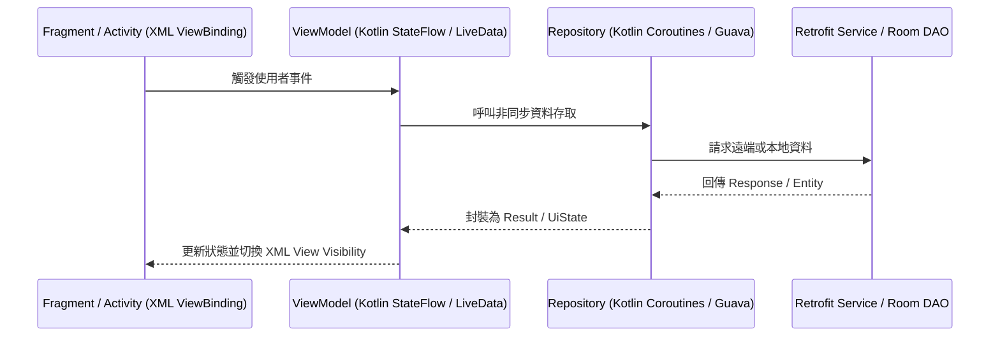

# [03-Tech-Design] <功能或重構名稱> — 導師制技術藍圖與學習鷹架

- **負責角色**：資深 RD Agent (`sr_rd_agent` — 嚴格唯讀導師模式)
- **🎓 本次唯一主修新技術 (1-New-Concept Budget)**：`[<節點編號與名稱>]`
- **實作者**：人類 RD（卡關時可隨時輸入 **`/coach`** 取得三段式漸進提示）

---

## 1. 架構設計與資料流 (MVVM Architecture & Data Flow)



## 2. 🎓 本次主修新技術深度講解 (Why & Before/After 對比)
### 2.1 為什麼在這裡導入這項技術？(The "Why")
- **專案既有舊寫法的痛點**：
- **新技術解決的核心問題與底層原理**：

### 2.2 觀念對照範例（通用範例，非本次直接解答）
- **🔴 舊有 Java / 傳統寫法**：
  ```java
  // 舊寫法示意
  ```
- **🟢 現代 Kotlin 慣用寫法**：
  ```kotlin
  // 新寫法觀念示意
  ```

## 3. 檔案新增與修改清單 (Affected Files)
| 動作 (`NEW` / `MOD`) | 檔案路徑 | 語言 (`Kotlin` / `Java` / `XML`) | 變更職責說明 |
| :---: | :--- | :---: | :--- |
| `NEW` | `app/src/main/java/com/robinhsueh/nerdia/...` | **Kotlin** | ... |
| `MOD` | `app/src/main/res/layout/...` | **XML** | ... |

## 4. 🧩 填空題式實作鷹架 (`// TODO(學習挑戰)`)
> 💡 **資深 RD 導師提示**：以下為您準備好類別結構與方法簽章，並在本次主修的新技術關鍵處留下 `// TODO(學習挑戰)`。請嘗試根據上方觀念自己動手寫出來；若遇到編譯問題或需要提示，隨時輸入 **`/coach`**！

```kotlin
// 類別與方法簽章鷹架
class TargetViewModel(...) : ViewModel() {

    // TODO(學習挑戰 1): 請嘗試宣告私有的 MutableStateFlow 與對外唯讀的 StateFlow
    // 提示：使用 asStateFlow() 確保外部 Fragment 無法直接修改狀態

    fun loadData() {
        // TODO(學習挑戰 2): 請在 viewModelScope 中啟動協程並更新狀態流
    }
}
```

## 5. 與既有 Java 程式碼互操作及 Lifecycle 注意事項
- **Java / Kotlin 雙向呼叫細節**：
- **記憶體安全與生命週期提醒**：
